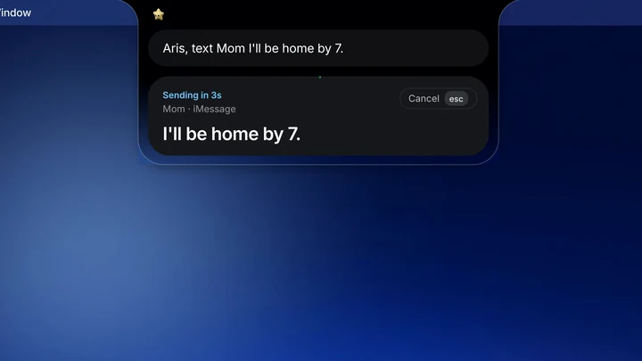

<p align="center">
  <picture><source media="(prefers-color-scheme: dark)" srcset=".github/logo-dark.svg" /></picture>
</p>

<p align="center">
  <a href="https://github.com/LumenJSN/Aris/releases/latest"><picture><source media="(prefers-color-scheme: dark)" srcset="https://shieldcn.dev/badge/release-v1.0.0.svg?variant=default&amp;size=sm&amp;color=2f5bea&amp;logo=lu:Sparkle&amp;logoColor=ffffff&amp;mode=dark" /></picture></a>
  <a href="https://arismac.app"><picture><source media="(prefers-color-scheme: dark)" srcset="https://shieldcn.dev/badge/website-arismac.app.svg?logo=lu:Globe&amp;variant=secondary&amp;size=sm&amp;mode=dark" /></picture></a>
  <picture><source media="(prefers-color-scheme: dark)" srcset="https://shieldcn.dev/badge/macOS-14%2B_Apple_silicon.svg?logo=apple&amp;variant=secondary&amp;size=sm&amp;mode=dark" /></picture>
  <picture><source media="(prefers-color-scheme: dark)" srcset="https://shieldcn.dev/badge/Swift-5.svg?logo=swift&amp;variant=secondary&amp;size=sm&amp;mode=dark" /></picture>
  <a href="LICENSE"><picture><source media="(prefers-color-scheme: dark)" srcset="https://shieldcn.dev/badge/license-Apache--2.0.svg?logo=lu:Scale&amp;variant=secondary&amp;size=sm&amp;mode=dark" /></picture></a>
  <picture><source media="(prefers-color-scheme: dark)" srcset="https://shieldcn.dev/badge/languages-Korean_%C2%B7_English.svg?logo=lu:Languages&amp;variant=secondary&amp;size=sm&amp;mode=dark" /></picture>
</p>

<h3 align="center">An agent for everything on your desktop.</h3>

<div align="center">

Aris lives in your MacBook's notch: hold a key and talk, or type. The AI you already use answers,
and anything that would act on your Mac asks you first. [arismac.app](https://arismac.app)

</div>

<p align="center">
  <a href="https://arismac.app"></a>
</p>

> [!WARNING]
> **Use at your own risk.** Aris lets an AI read and act on your Mac: messages, mail, files, calendar and other apps'
> windows. It asks before anything that writes, sends or deletes, but it is a personal project with no warranty.
> Read the [safety model](#safety-model) and the licence's disclaimer ([LICENSE](LICENSE), sections 7 and 8) before
> you grant it permissions.

## Getting started

1. Install Aris (see [Install](#install)) and open it. It sets up its background helper by itself and walks you
   through the permissions.
2. Give it a brain: log in to Claude Code, Codex or Antigravity, or add an API key or a local model in
   Settings › AI services (see [Brains](#brains)).
3. Hold <kbd>⌥ Space</kbd> and speak, or click the notch and type.
4. When Aris wants to send, write or delete something, a **confirm card** shows exactly what will happen. Edit it,
   say yes, or cancel.
5. Hold the right <kbd>⌥</kbd> to dictate into any app. History, usage, to-dos and the calendar live in the side
   notches.

## Install

Requires a Mac with **Apple silicon** and **macOS 14 Sonoma or later**. The notch's glass look needs macOS 26; older
systems get a plain dark notch. Macs without a notch work too.

1. Download `Aris-<version>.dmg` from [Releases](https://github.com/LumenJSN/Aris/releases/latest) and open it.
2. Drag **Aris** onto **Applications**, then open it from there.

Aris is ad-hoc signed and **not notarized** (the project has no Developer ID), so the first launch is refused
("Apple could not verify Aris"). Allow it once per download, in one of these ways:

- **System Settings**: click Done, go to Privacy & Security, scroll down and click **Open Anyway** next to the Aris
  message, then confirm.
- **Terminal**: clear the download quarantine flag.

  ```sh
  xattr -dr com.apple.quarantine /Applications/Aris.app
  ```

Only do this for a copy you downloaded from this repository's Releases page. The release also has a `.zip` of the
same app and a `SHA256SUMS` file; compare with `shasum -a 256 Aris-<version>.dmg`. The official build includes the
onboarding's sounds and its recorded greeting.

**After an update** macOS sees a new program, so grant the permissions again. If a switch in System Settings already
shows on, turn it off and on, or remove the row with − and add Aris again.

### Build from source

Needs **Xcode 26 or later** (the full app, not only the command-line tools); no paid developer account.

```sh
git clone https://github.com/LumenJSN/Aris.git
cd Aris
./Scripts/build.sh    # the app, aris-agent and aris-tools, signed ad-hoc into build/Aris.app
```

Move `build/Aris.app` to `/Applications` and open it. `Scripts/deploy.sh` builds, checks, signs, swaps the installed
copy and restarts the helper in one step (`--rollback` puts the previous build back); [docs/BUILD.md](docs/BUILD.md)
explains every part and script.

With ad-hoc signing every rebuild is a new program to macOS, so permissions must be granted again. To keep them, sign
with a free "Apple Development" certificate from Xcode › Settings › Accounts:
`SIGN_ID="Apple Development" ./Scripts/build.sh`. The project contains no team id.

A build from source has no onboarding sounds (they are not in the repository, see
[OnboardingAudio](Aris/private/Aris/Onboarding/OnboardingAudio/README.md)); the Mac's own voice speaks the greeting.

## Features

- **Talk or type in the notch.** Answers, confirm cards and running work show in the notch; history, usage, to-dos
  and the calendar in the side notches.
- **Your choice of brain**: Claude Code (recommended), Codex, Antigravity, an API key or a local model. Every feature
  works on every brain.
- **Works on your Mac**: Messages, Mail, Notes, Calendar, Reminders, Contacts, Finder and files (convert, merge,
  shrink, move, undo), music, timers, weather, stocks, maps and currency. Other apps' windows can be read and
  operated through [Peekaboo](https://github.com/openclaw/Peekaboo), downloaded on first use.
- **Sees what you point at**: ask about the screen, circle something with the gesture, or pick windows to ask about.
- **Dictation** into any app, with a learned dictionary and your own writing style.
- **Hands-free conversation**, with on-device end-of-turn detection and barge-in.
- **Teammates**: background workers (a clone of Aris, Claude Code in a terminal) that take a job and report back.
- **Skills** in the open Agent Skills format (`SKILL.md` plus optional `scripts/`, `references/`, `assets/`), so
  skills made for Claude Code or Codex work unchanged on every brain. They are off until you turn them on, each is
  checked by a static scan ([SkillSpector](https://github.com/NVIDIA/skillspector)) and a review by your AI first, and
  a skill's scripts run only after you say yes.
- **Memory** you can read and edit: plain Markdown notes about how you like things done, kept on your Mac.
- **Korean and English** in the UI, the voice and the answers.

## Permissions

Aris asks for each one when a feature first needs it. Each is a single "Aris" row in System Settings › Privacy &
Security (the helper and tools inside the app count as the app).

| Permission | What Aris does with it |
| --- | --- |
| Microphone | hears you while you hold the talk key, in a hands-free conversation, and for its name if the wake word is on |
| Speech Recognition | turns speech into text on the Mac (an on-device Whisper model is an option) |
| Accessibility | finds and presses buttons and fields in other apps, types for you, reads the selection and the focused window |
| Screen Recording | sees the screen only when you point, circle or pick a window; password apps and Aris's own windows are always left out |
| Full Disk Access (optional) | reads Messages, Mail and Notes; never writes there |
| Desktop, Documents, Downloads | moves, converts and restores your files when you ask |
| Calendars, Reminders, Contacts | shows and edits events and to-dos, finds the person you name |
| Automation | controls Music, Spotify, Notes, Finder, Messages, Mail and the terminal Claude Code runs in, for what you ask |

## Brains

Pick the default in Settings › AI services; saying the name first ("ask Gemini …") picks one for that request.

| Brain | How to add it |
| --- | --- |
| **Claude Code** (recommended) | install [Claude Code](https://docs.anthropic.com/en/docs/claude-code), run `claude` once in Terminal and log in |
| **Codex** | install the [Codex CLI](https://github.com/openai/codex) and run `codex login` with your ChatGPT account |
| **Antigravity** (Gemini) | install Antigravity's CLI and run `agy` once to log in |
| **An API key** | OpenAI, Anthropic, Gemini API, OpenRouter, Groq, xAI, Mistral or DeepSeek, in Settings › AI services › API |
| **A local model** | run [Ollama](https://ollama.com) or [LM Studio](https://lmstudio.ai) on the Mac and pick it in the same list |
| **Anything OpenAI-compatible** | add its address, key and model in the same list |

Aris looks for the CLIs in `~/.local/bin`, `/opt/homebrew/bin` and `/usr/local/bin`. Keys stay in the macOS
Keychain. The voice is the Mac's own by default; ElevenLabs or OpenAI speech work with your key.

Optional: `Scripts/install-claude-hooks.py` (and `install-agent-hooks.py` for Codex and Gemini CLI) show your coding
sessions in the notch and let you answer Claude Code's permission prompts there. Both are dry runs until you pass
`--apply`, and both back up the file they change.

## Privacy

- **Stays on your Mac**: history, memory notes, schedules, settings, skills and logs (in `~/.config/aris` and the
  app's container), the wake word, the end-of-turn model, the dictation dictionary and the Mac's speech recognition.
  No server, no account, no analytics. The helper listens on `127.0.0.1` only, behind a token.
- **Goes to the AI you chose**: your request, the context it needs (the time, the app in front, what you selected or
  pointed at, the memory notes that apply) and the results of its steps, such as a message you asked it to read.
  That goes to the company behind your CLI or API under their terms, or stays on the Mac with a local model.
- **Other services, only when used**: weather, stocks, maps and currency lookups, a web page you ask about,
  ElevenLabs or OpenAI speech if you set a key, and GitHub for the first-use downloads (Peekaboo, SkillSpector and
  its Python runtime, the Whisper model).

## Safety model

Every step any brain wants to take goes through one gate in `aris-agent`. Reading runs without asking. Anything that
writes, sends, deletes, spends or automates another app shows a **confirm card** that says exactly what will happen
(who gets the message and its words, which file goes where) and waits for your yes; you can edit the values first.
A few things are never done (paying, wiping a disk, touching the system's protected places), and a command the gate
cannot read is treated as the riskiest kind. After you allow the same thing three times in a row, Aris offers to stop
asking; Settings lists and revokes those.

Text from outside (a web page, an e-mail, a message, a file, a skill) is **tainted**: it reaches the brain as fenced,
labelled data, and a turn that has read it can no longer act on its own. From then on even steps that normally run
need your yes, and nothing learned in that turn is trusted as your own words. Sends are confirmed one by one with the
exact text, and Aris checks the window is still the one on the card before it presses anything.

## Notes

- **Private Apple APIs.** Each is looked up at run time, with a public fallback where one exists:
  - AppKit's private glass settings on `NSGlassEffectView` (variant, content lensing, a custom path) and
    `_setHasActiveAppearance:` on the notch window, for the notch's look on macOS 26;
  - CoreGraphics' `CGSSpace*` and SkyLight's `SLSRemoveWindowsFromSpaces`, to keep the notch above full-screen apps
    and on the lock screen (with [SkyLightWindow](https://github.com/Lakr233/SkyLightWindow));
  - `_AXUIElementGetWindow`, to match an accessibility element to its window;
  - MediaRemote (through the bundled [mediaremote-adapter](https://github.com/ungive/mediaremote-adapter)) for what
    is playing, and DisplayServices for the screen's brightness.

  Any macOS update can change or remove them, and they are why Aris can't be in the App Store.
- **Not notarized**: there is no Developer ID; see [Install](#install).
- No other app's code, artwork, sounds, fonts or prompts are included.
- Aris is not affiliated with Anthropic, OpenAI, Google or any provider it can talk to; their names belong to them
  and are shown only to say which brain is which.

## Build and test

```sh
./Scripts/build.sh                 # the app, aris-agent and aris-tools, assembled and signed into build/Aris.app
./Scripts/build.sh --agent-only    # only aris-agent and aris-tools (a minute; no Xcode project build)
bash Tests/run.sh                  # the test suite (about 400 files compiled; ends in ALL PASSED)
bash Tests/deploy-dry-tests.sh     # deploy.sh and the installers against a sandbox of fakes
```

The tests compile the Foundation-only parts of the app, the helper and the tools into one program and run them with
a throwaway home folder; they never touch your real data, preferences, permissions or the installed Aris.

## Credits

Third-party notices are in [THIRD_PARTY_LICENSES](THIRD_PARTY_LICENSES) and [NOTICE](NOTICE).

## License

Aris is released under the [Apache License 2.0](LICENSE). Copyright 2026 Lumen.

Contributions are welcome; see [CONTRIBUTING.md](CONTRIBUTING.md). Please report security problems privately as
described in [SECURITY.md](SECURITY.md).
